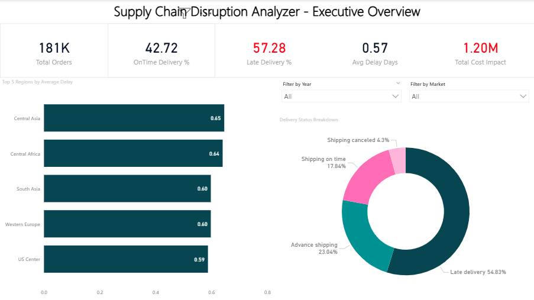
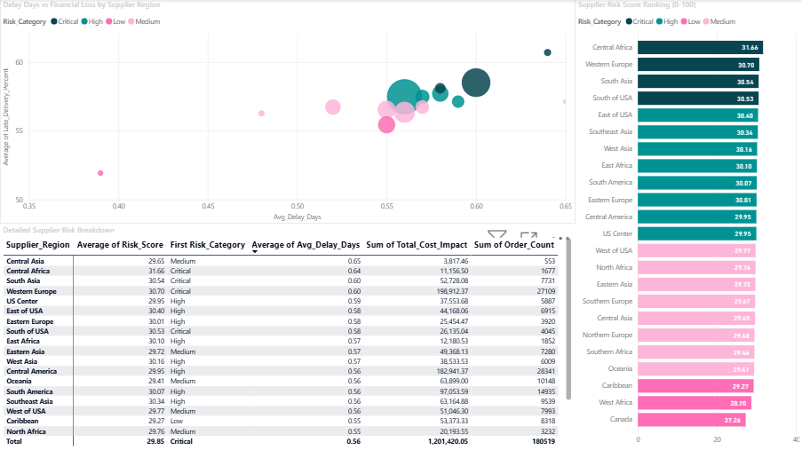
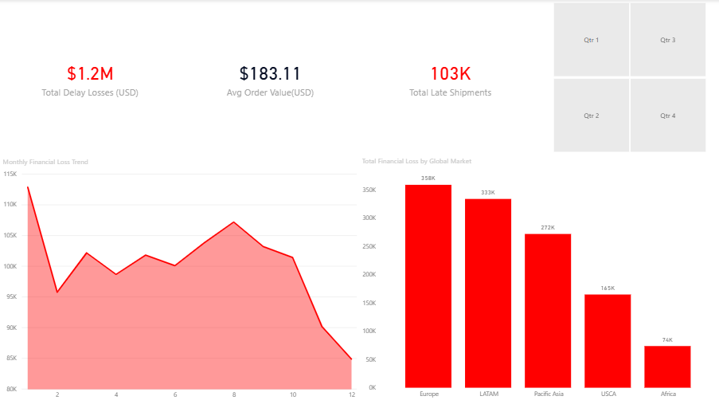

# Supply Chain Disruption Analyzer

[](https://github.com/rohan912-456)
[](python/requirements.txt)
[](sql/)
[](LICENSE)

Built an end-to-end data analytics project using Excel, SQL, Python, and Power BI to analyze 180,519 supply chain orders across 5 global markets and uncover why 57.3% of deliveries are late — nearly 4x the industry benchmark.

The project uses a 59-column dataset covering orders from 2015 to 2018 to identify high-risk supplier regions, quantify the financial impact of delivery delays ($1.2M+ in losses), and build a supplier risk scoring model that ranks all 23 regions on a 0-to-100 risk scale.

### How it was done:
- **Excel:** Audited data quality across 59 columns and 180,519 rows. Used pivot tables to discover that 57.3% of all orders arrive late.
- **SQL (MySQL):** Wrote analytical queries using GROUP BY, HAVING, CASE WHEN, and aggregation functions to break down delays by region, delivery status, product category, and monthly trends.
- **Python:** Used Pandas, NumPy, Seaborn, and Matplotlib to compute correlations and build a weighted risk scoring model (40% delay severity + 40% shipping reliability + 20% loss rate) that scores all 23 supplier regions.
- **Power BI:** Built a 3-page interactive dashboard for the executive team, procurement team, and finance team with DAX-powered KPI cards and interactive visuals.

## Key Findings
- **Late Delivery Crisis:** 57.3% of all 180,519 orders are delivered late — the industry benchmark is only 15%.
- **$1.2M+ in Losses:** Delivery delays cost the company $1,201,420 in losses, which is 3.63% of total sales revenue ($33.05M).
- **Highest Risk Region:** Central Africa has the highest supplier risk score (31.66/100) with an average delay of 0.64 days and 60.7% late delivery rate.
- **All Markets Affected:** All 5 global markets have nearly identical late delivery rates (~54-55%), suggesting a systemic issue rather than a regional one.
- **Europe Hit Hardest:** Europe alone accounts for $358,309 in delay losses — the highest dollar amount of any market.
- **Average Loss Per Late Order:** Each late order costs an average of $11.62 in financial impact.
- **Monthly Volatility:** Financial losses from delays show seasonal spikes, indicating predictable periods where buffer inventory is needed.

## Power BI Dashboard
The project includes an interactive 3-page Power BI report.

### Page 1: Executive Overview


### Page 2: Supplier Risk Analysis


### Page 3: Financial & Trend Analysis


## Project Architecture & Analytics Lifecycle

### 📊 Phase 1: Excel
**Data Profiling & Cleaning**<br>
Audited 180,519 order records across 59 columns for data quality. Removed duplicates, fixed date formats, and standardized numeric fields. Pivot table analysis revealed the core problem: **57.3% late delivery rate** — nearly 4 times the industry standard of 15%.
```excel
=COUNTBLANK(A2:A180520)
```
*(Used to audit null counts across all 59 columns)*

### 🗄️ Phase 2: MySQL
**Analytical Queries & Regional Analysis**<br>
Imported the cleaned dataset into MySQL and wrote analytical queries using GROUP BY, HAVING, ROUND, CASE WHEN, and SUBSTRING_INDEX to analyze delays by supplier region, delivery status, product damage rates, and monthly trends. Discovered that **Central Africa** has the worst delay metrics (0.64 days avg) and **Western Europe** has the highest total cost impact ($198,912).
```sql
SELECT 
    SUBSTRING_INDEX(OrderRegion, ',', 1) as Supplier_Region,
    COUNT(*) as Total_Orders,
    ROUND(AVG(DelayDays), 2) as Avg_Delay_Days,
    ROUND((COUNT(CASE WHEN DelayDays > 0 THEN 1 END) / COUNT(*)) * 100, 1) as Late_Delivery_Percent
FROM supply_chain_orders
GROUP BY Supplier_Region
HAVING Total_Orders > 100
ORDER BY Avg_Delay_Days DESC
LIMIT 10;
```

### 🐍 Phase 3: Python
**Correlation Analysis & Risk Scoring Model**<br>
Used Pandas, NumPy, Seaborn, and Matplotlib to compute a Pearson correlation matrix across 8 key numeric features and build a weighted supplier risk scoring model. Each of the 23 supplier regions gets a score from 0 to 100 based on three factors: **delay severity (40%)**, **shipping reliability (40%)**, and **product loss rate (20%)**. Central Africa scored highest at 31.66, while Canada scored lowest at 27.26.
```python
risk_score = (delay_score * 0.4) + (late_score * 0.4) + (loss_score * 0.2)
```

### 📈 Phase 4: Power BI
**Interactive 3-Page Dashboard**<br>
Built a 3-page Power BI report using DAX measures. Page 1 gives the executive team a health check using 5 KPI cards and 2 interactive charts. Page 2 visualizes the Python risk scoring model output for the procurement team as a ranked supplier risk matrix. Page 3 shows time-series financial trends and market-level loss breakdowns for the finance team.
```dax
Late Delivery % = 
DIVIDE(
    CALCULATE(COUNTROWS('supply_chain_ready'), 'supply_chain_ready'[DeliveryStatus] = "Late delivery"),
    COUNTROWS('supply_chain_ready')
)
```

## 💡 Strategic Recommendations

| Strategic Pillar | Identified Root Cause | Proposed Intervention | Expected Business ROI |
| :--- | :--- | :--- | :--- |
| **1. Fix Late Delivery Crisis** | 57.3% of 180,519 orders arrive late — nearly 4x the industry benchmark of 15%. | Implement financial SLA penalties for couriers exceeding 0.5-day average delay. | Reduces late deliveries and associated $1.2M+ in annual losses. |
| **2. Prioritize High-Risk Regions** | Central Africa (Risk Score: 31.66/100) has the worst delay performance with 60.7% late deliveries. | Launch emergency operational reviews and consider backup suppliers for the top 5 risk regions. | Prevents supply chain disruptions in regions responsible for the highest delay rates. |
| **3. Build Seasonal Buffers** | Monthly loss data shows predictable seasonal spikes in financial impact. | Increase safety stock by 20% in high-risk regions during peak delay months. | Shields customers from fulfillment delays during known high-risk periods. |
| **4. Address Western Europe Losses** | Western Europe has the highest total cost impact at $198,912 across 27,109 orders. | Establish priority routing and real-time tracking for Europe's high-volume corridors. | Reduces losses in the single costliest market by order volume and financial impact. |

## Repository Directory Structure
```text
Supply-Chain-Disruption-Analyzer/
├── README.md                           ← Executive case study
├── LICENSE                             ← MIT License
├── .gitignore                          ← Ignores temp files
│
├── assets/                             ← Visual assets
│   ├── dashboards/
│   │   ├── page1_executive_overview.png
│   │   ├── page2_supplier_risk.png
│   │   └── page3_financial_trends.png
│   └── python_visuals/
│       ├── 01A_Delay_Distribution.png
│       ├── 01B_Delivery_Composition.png
│       ├── 02_Supplier_Risk_Analysis.png
│       ├── 03_Trend_Analysis.png
│       └── 04_Correlation_Heatmap.png
│
├── data/
│   ├── raw/
│   │   ├── column_descriptions.csv     ← Kaggle column metadata
│   │   └── README.md                   ← How to get the raw data
│   └── processed/
│       ├── excel/
│       ├── powerbi/
│       ├── python/
│       │   ├── market_analysis.csv         ← Python output
│       │   └── supplier_risk_analysis.csv  ← Python risk scores
│       └── sql/
│           ├── 01_regional_delay_frequency.csv
│           ├── 02_delay_by_delivery_status.csv
│           ├── 03_product_damage_loss.csv
│           ├── 04_monthly_trend.csv
│           ├── 05_supplier_risk_scores_sql.csv
│           ├── 06_market_performance.csv
│           └── 07_region_market_breakdown.csv
│
├── excel/
│   └── README.md                       ← Excel file too large for GitHub
│
├── power_bi/
│   └── Supply_Chain_Dashboard.pbix     ← Interactive Power BI dash
│
├── python/
│   ├── Supply_Chain_Data_Analytics_Project.ipynb ← Full EDA & Risk Scoring
│   └── requirements.txt               ← Python dependencies
│
└── sql/
    ├── 00_schema_setup.sql             ← Database & table schema
    ├── 00_import_to_mysql.py           ← CSV-to-MySQL import script
    └── 01_analytical_queries.sql       ← Core analytical queries
```

## 👨‍💻 Author & Contact

**Rohan Nandanwar**  
*Data Analyst | Class of 2026 Graduate*

If your team is hiring, or if you'd just like to chat about this project or data analytics in general, I would love to connect!

- 💼 **LinkedIn:** [linkedin.com/in/rohan4560](https://www.linkedin.com/in/rohan4560/)
- 💻 **GitHub:** [github.com/rohan912-456](https://github.com/rohan912-456)
- 📧 **Email:** [rohnandanwar456@gmail.com](mailto:rohnandanwar456@gmail.com)

---
⭐ *If you found this project interesting, a star on the repository is greatly appreciated!*
